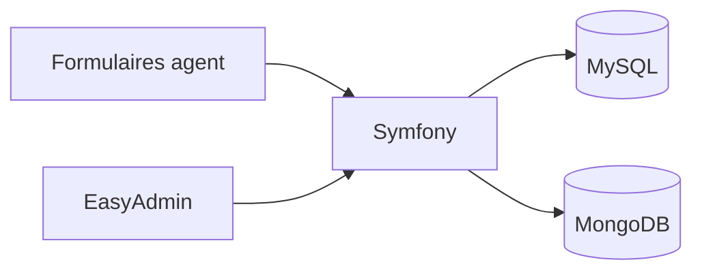

# DIRM Méditerranée

Application des **demandes administratives** de la Direction interrégionale de la mer Méditerranée : mobilité des agents, habilitations aux outils métier, déclarations de mise en chantier, et lecture des risques.

<p align="center">
  
  
  
  
  
</p>

<p align="center">
  <strong>Dépôt :</strong> <a href="https://github.com/Meriem1403/Dirm">github.com/Meriem1403/Dirm</a>
  &nbsp;·&nbsp;
  <strong>Branche :</strong> <code>final</code>
</p>

---

## Sommaire

- [Présentation](#présentation)
- [Fonctionnalités](#fonctionnalités)
- [Stack technique](#stack-technique)
- [Architecture](#architecture)
- [Prérequis](#prérequis)
- [Installation et développement](#installation-et-développement)
- [Tests](#tests)
- [Sécurité](#sécurité)
- [Structure du projet](#structure-du-projet)
- [Dépôt voisin](#dépôt-voisin)

---

## Présentation

Les agents déposent une demande depuis un formulaire guidé. L'administration la suit, la notifie et la rattache à un service, un lieu et un rôle. Une partie du référentiel (risques, domaines) est consultable sans sortir de l'application.

Le prototype de formulaires, plus court, est dans [DIRMTEST](https://github.com/Meriem1403/DIRMTEST). La branche suivie de ce dépôt est `final`.

---

## Fonctionnalités

| Module | Description |
|--------|-------------|
| **Mobilité** | Demande de mobilité d'un agent |
| **Habilitations** | Accès aux outils métier (Cerbère, profils) |
| **Mise en chantier** | Déclaration de chantier et personnes à bord |
| **Risques** | Fiches risques, compréhension des risques, retours d'action |
| **Services et lieux** | Référentiel des services et des sites |
| **Notifications** | Suivi des demandes |
| **Comptes** | Inscription, connexion, rôles |
| **Administration** | EasyAdmin sur les entités |

---

## Stack technique

| Couche | Technologies |
|--------|----------------|
| Backend | PHP 8.2, Symfony 7.3, Twig, Stimulus |
| Admin | EasyAdmin 4 |
| Données | Doctrine ORM, MySQL, MongoDB |
| Assets | Webpack Encore, Tailwind CSS |
| Documents | PhpSpreadsheet |
| Tests | PHPUnit |
| Conteneurisation | Docker Compose, `Dockerfile.php` |

---

## Architecture



MySQL porte les demandes et les comptes. MongoDB sert les jeux documentaires branchés sur l'application.

---

## Prérequis

- **Docker** et Docker Compose
- **Git**

---

## Installation et développement

```bash
git clone https://github.com/Meriem1403/Dirm.git
cd Dirm
git checkout final
docker compose up --build
```

L'application répond sur le port **8000**. MySQL vient avec le même compose. Les variables `MYSQL_*` ont des valeurs de développement dans `compose.yaml` : les remplacer avant tout usage partagé.

Créer un `.env.local` (non versionné) avec `APP_SECRET` et `DATABASE_URL`. Ne jamais y coller un mot de passe de messagerie réelle.

Les fichiers `migrations*.sql` décrivent l'évolution du schéma. Les migrations Doctrine restent la voie normale (`php bin/console doctrine:migrations:migrate`).

---

## Tests

```bash
php bin/phpunit
```

Les tests de contrôleurs couvrent au minimum l'accueil et la sécurité (`tests/Controller`).

---

## Sécurité

- `.env` hors de Git.
- Rôles Symfony et EasyAdmin réservés à l'administration.
- Formulaires avec protection CSRF.
- Aucun mot de passe applicatif publié dans le dépôt. S'il en a existé un dans un ancien historique, le révoquer côté fournisseur : l'effacement du fichier ne révoque pas la clé.

---

## Structure du projet

```
Dirm/
├── src/Controller/        # Demandes, risques, sécurité, notifications
├── src/Entity/            # Mobilité, chantier, Cerbère, services
├── templates/
├── migrations/
├── tests/
├── compose.yaml
└── Dockerfile.php
```

---

## Dépôt voisin

| Dépôt | Rôle |
|-------|------|
| [DIRMTEST](https://github.com/Meriem1403/DIRMTEST) | Prototype Symfony des formulaires |
| [Lecompas](https://github.com/Meriem1403/Lecompas) | Gestion des risques et document unique |
| [Hublot](https://github.com/Meriem1403/Hublot) | Tableau de bord des effectifs |

---

<p align="center">
  <sub>Direction interrégionale de la mer Méditerranée — demandes administratives. Branche de référence : <code>final</code>.</sub>
</p>
